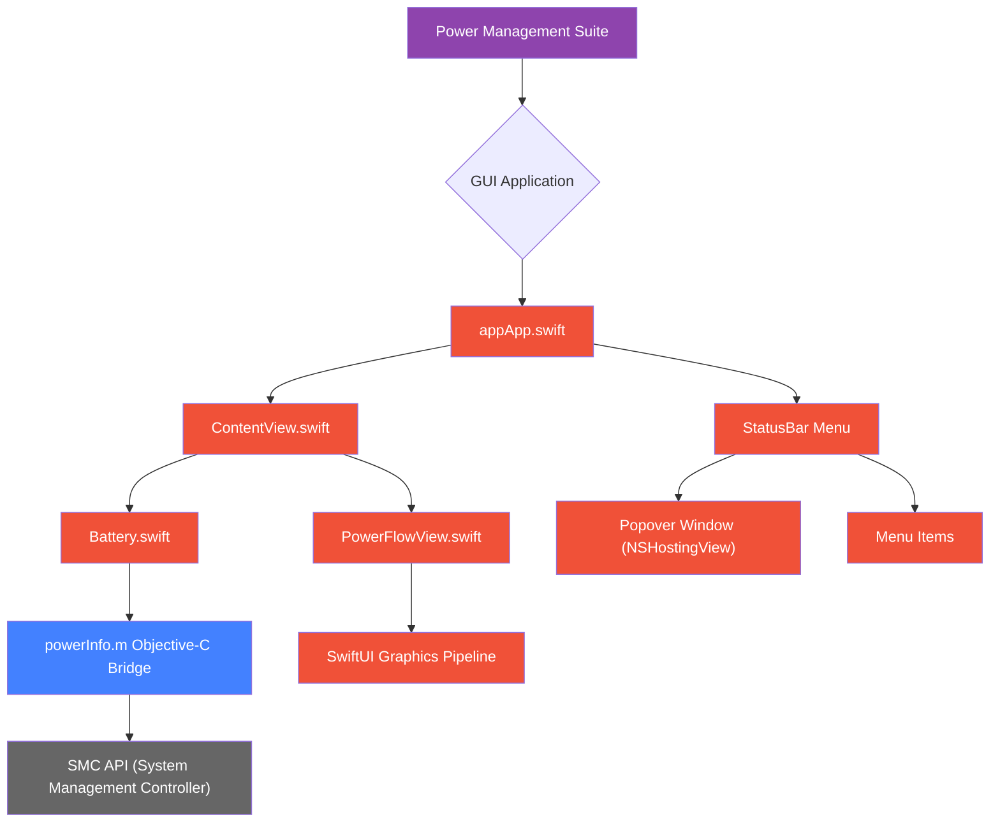

# Power Management Suite

[]()
[](https://www.gnu.org/licenses/gpl-3.0)

A comprehensive power monitoring solution for macOS featuring:

- 🖥 GUI application with real-time power flow visualization
- 🔋 Detailed battery health analytics
- ⚡️ CLI tools for low-level power monitoring
- 📊 System load statistics collection

- Initial app icon (This icon is open to creative reinterpretation by anyone.)

  

## Architecture Overview



## Features

### GUI Application
- Real-time power flow visualization
- Battery health monitoring (cycles, capacity, temperature)
- Adapter power input tracking
- System load/power consumption correlation
- Pause charging while plugged in: the Mac keeps running on the adapter, but the battery is not charged

### Pausing Charging
The toggle at the top pauses battery charging without unplugging. Since macOS 27 the SMC charging keys used by
[batt](https://github.com/charlie0129/batt) are no longer available, so BattGUI uses macOS's own Charge Limit instead:
pausing sets the limit just above the current charge, and resuming restores your previous limit immediately, without
a password. The limit is always kept above the live charge, because macOS runs the Mac from the battery while the
charge is above the limit.

System Settings only offers limits of 80–100%; lower limits are written to the underlying preference as root, so
pausing below 79% asks for an administrator password. To use Touch ID instead, enable it for `sudo`:
```bash
sed -e 's/^#auth/auth/' /etc/pam.d/sudo_local.template | sudo tee /etc/pam.d/sudo_local
```

## Requirements

- macOS 13 Ventura or newer
- Xcode 15+
- Administrator password (or Touch ID for `sudo`) to pause charging

## Installation

### DMG Installation
1. Download the latest `.dmg` package from our [Releases page](https://github.com/clzoc/BattGUI/releases)
2. Open the downloaded DMG file
3. Drag the application to your `Applications` folder

### Manual Installation (From Source)
1. Build the application:
```bash
# Clone repository
git clone https://github.com/clzoc/BattGUI.git
cd power-suite
xcodebuild -workspace app.xcodeproj/project.xcworkspace -scheme app
```

### Alternative Installation
1. **GateKeeper Configuration**
   If you encounter security warnings:
   - Go to `System Settings` → `Privacy & Security` → scroll down to `Security`
   - Click "Open Anyway" next to the BattGUI warning
   - Confirm execution in the dialog

2. **Advanced Configuration (Admin required)**
   For system-level monitoring access:
```bash
# Temporarily disable GateKeeper (resets after reboot)
sudo spctl --master-disable
```
## Usage

GUI Application:
```bash
open app/build/Release/app.app
```


## Known Issues

- **Adapter Voltage Detection**: Current implementation fixes adapter voltage at 20.00V due to missing SMC key in [VirtualSMC documentation](https://github.com/acidanthera/VirtualSMC/blob/master/Docs/SMCKeys.txt). Amperage is calculated using I = P / U. Contributions welcome to identify the correct SMC key.

- **UI/UX Optimization**: Ongoing improvements to power management workflows including:
  - Enhanced real-time measurement visualization
  - Historical data trending
  - Customizable power profiles

## Contributing
See [CONTRIBUTING.md](CONTRIBUTING.md) for development setup and guidelines.

## License
GPLv3 (see [LICENSE](LICENSE))
